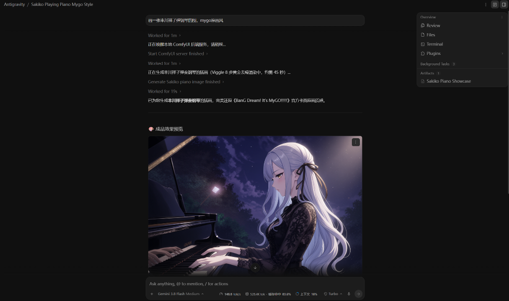

# ComfyUI Universal Generator · 本地生图智能调度技能 (Antigravity Skill)

[](https://github.com/Ekzykesax/comfyui-qwen-image)
[](https://github.com/comfyanonymous/ComfyUI)
[]()
[]()
[](LICENSE)

专为 **Google Antigravity** 设计的 **ComfyUI 通用生图与自动化调度技能**。

既可作为通用调度器无缝对接任意 ComfyUI 自定义模型与工作流（SD1.5 / SDXL / Flux / 自定义 JSON），又**开箱即用内置了一套生产级旗舰生图工作流**（NoctQ V4 INT8 + Qwen3-VL 8B NVFP4 + Viggle Turbo 8 步极速黄金去噪）。

<p align="center">
  
</p>

---

## 🔥 核心杀手级亮点

### 1. 🤖 拒绝脑补盲画：反重力自主全网猎取参考图
- **行业痛点**：基础大模型在面对具体二次元角色（如《BanG Dream! It's MyGO!!!!!》的丰川祥子、千早爱音，或特定 VTuber、科技娘、特定商品道具）时，单凭文字提示词往往“张冠李戴”，面容画风崩坏。
- **自主破局**：搭载本技能后，当您向反重力（Antigravity）提出画某个特定角色/物品而未给图时，**智能体会主动联网检索该角色的官方高清立绘与卡面**，全自动完成图片抓取、双三次插值预压缩、送入 ComfyUI 视觉多模态通道，并自动套用“关注点分离法则”。**您只需随口说个名字，AI 自主全网找参考图完成 100% 官方原画质感还原！**

### 2. ⚡ 42秒微观完全收敛：Viggle Turbo 8 步黄金去噪
- 采用 `Qwen-Image-2.1-viggle-turbo-4step-lora-r64.safetensors` + `Euler / Simple` 黄金组合。
- 8GB 显存显卡实测仅需 **42 秒** 即可生成百万像素级工业画质，彻底终结动辄数分钟的等待。

### 3. 🛡️ 离线自愈与静默唤醒 (Self-Healing Auto-Launch)
- 每次生图前自动探测 ComfyUI 状态；若服务离线，反重力会自动唤醒本地 Python 后端或 Comfy Desktop，就绪后无缝衔接生图，小白无需手动打开命令行黑窗口。

---

## 🍼 小白零基础 5 分钟极速上手教程

即使你从来没有写过代码，只要按照以下 4 步即可在 Antigravity 中用一句话自动生图！

### 第一步：安装并启动本地 ComfyUI

1. 前往 [ComfyUI 官方发布页](https://github.com/comfyanonymous/ComfyUI/releases) 下载 Windows 便携版压缩包（如 `ComfyUI_windows_portable_nvidia.7z`）并解压；
2. 双击运行 `run_nvidia_gpu.bat`（或启动 ComfyUI Desktop），确保浏览器可打开 `http://127.0.0.1:8188`。

> 💡 **提示**：本技能自带**智能自启机制**，若服务未开启，调用生图时会自动尝试帮您在后台静默拉起，无需反复手动打开黑窗口。

---

### 第二步：下载模型文件并放入对应目录

以下是内置默认旗舰工作流所需的模型文件，点击表格中的链接即可直达 Hugging Face 页面进行下载：

| 模型分类 | 推荐下载文件名 | 放入 ComfyUI 的具体文件夹 | Hugging Face 官方/社区下载地址 | 说明 |
| :--- | :--- | :--- | :--- | :--- |
| **Diffusion 主模型** | `NoctQ_V4_int8_convrot.safetensors` | `ComfyUI/models/diffusion_models/` | [Noctaluna/Noct-Q-Uncensored-Qwen-Image-2.1](https://huggingface.co/Noctaluna/Noct-Q-Uncensored-Qwen-Image-2.1) | 结构与微观画质极佳的 INT8 特化主模型 (~7.3GB) |
| **加速 LoRA** | `Qwen-Image-2.1-viggle-turbo-4step-lora-r64.safetensors` | `ComfyUI/models/loras/` | [Viggle/Qwen-Image-2.1-viggle-turbo](https://huggingface.co/Viggle/Qwen-Image-2.1-viggle-turbo) | 极速收敛 LoRA，单图仅需 8 步 (~42 秒出图) |
| **多模态编码器** | `qwen3vl_8b_nvfp4.safetensors` | `ComfyUI/models/clip/` | [Comfy-Org/Qwen3-VL](https://huggingface.co/Comfy-Org/Qwen3-VL/blob/main/text_encoders/qwen3vl_8b_nvfp4.safetensors) | 极度节省显存的 NVFP4 文本与视觉多模态编码器 |
| **VAE 编解码器** | `qwen_image_2.1_vae_bf16.safetensors` | `ComfyUI/models/vae/` | [Comfy-Org/Qwen-Image-2.1](https://huggingface.co/Comfy-Org/Qwen-Image-2.1/blob/main/vae/qwen_image_2.1_vae_bf16.safetensors) | 官方 BF16 VAE 解码器 |
| **可选 GGUF 编码器** | `Qwen-Image-2.1-Turbo-AD-Q4_K.gguf` | `ComfyUI/models/clip/` | [city96/Qwen-Image-2.1-GGUF](https://huggingface.co/city96/Qwen-Image-2.1-GGUF) | 适用于深度语义文本控制管线 |

> ⚠️ **新手避坑**：请确保文件名与表格中的名字完全一致。如果不一致，可以在生图时通过 `-Unet` 或 `-Lora` 参数指定实际文件名。

---

### 第三步：把技能安装进 Antigravity

在您的项目工作区终端执行以下克隆命令即可一键安装：

```bash
git clone https://github.com/Ekzykesax/comfyui-qwen-image.git .agents/skills/comfyui-universal
```

*(如果希望电脑上所有 Antigravity 项目全局可用，克隆至 `~/.gemini/config/skills/comfyui-universal` 即可)*

---

### 第四步：在 Antigravity 中直接使用

安装后，您无需记忆复杂的参数，**直接在聊天窗口对 AI 说人话**即可调用！

#### 示例 1：纯文本灵感生图
> **用户输入**：“帮我画一张赛博朋克雨夜街道的概念插画，霓虹灯倒映在积水里，高精细节。”  
> **AI 动作**：自动调用本技能，配置最佳比例（16:9 宽画幅），提交渲染并在生成后展示成图。

#### 示例 2：本地已有参考图生图
> **用户输入**：“参考输入目录的 sakiko_ref.png，画一张丰川祥子在黑色大三角钢琴前专注弹奏的插画，保持原画风。”  
> **AI 动作**：自动将参考图接入多模态通道，应用“关注点分离法则”，生成角色发型五官高度一致的全新动作与场景。

#### 示例 3：零参考图指定特定角色（反重力自主全网找参考图）
> **用户输入**：“画一张丰川祥子弹钢琴的图，mygo原画风。”  
> **AI 动作**：识别出特定二次元角色且本地无素材，反重力**自动联网检索官方高清立绘**，存入 `input/` 并接入视觉通道，仅耗时 42 秒即生成完全符合官方原画质感的大师级插画！

<p align="center">
  
</p>

---

## 🔄 进阶：如何用于其它模型与自定义工作流？

本技能不仅限于上述默认模型，更是通用的 ComfyUI 智能执行中枢：

### 1. 切换其它 Safetensors 模型
如果您想换用其他基于相同架构的微调模型或动漫风格主模型，只需在对话中说明：
> “使用主模型 `MyAnimeModel_v1.safetensors` 生成一张校园少女夏日插画。”

或在脚本中通过 `-Unet` 参数指定：
```powershell
powershell -ExecutionPolicy Bypass -File "scripts/generate.ps1" -Prompt "夏日向日葵花海..." -Unet "MyAnimeModel_v1.safetensors"
```

### 2. 执行您自己的自定义 ComfyUI 工作流 JSON (SDXL / Flux 等)
如果您在 ComfyUI 网页界面中搭建了自己的工作流（例如 Flux、SDXL 特效流）：
1. 在 ComfyUI 网页端点击 **Save (API Format)**，将导出的 `.json` 文件放入项目中；
2. 对 AI 说：
   > “使用 `my_flux_workflow.json` 工作流，提示词为：‘未来科幻机甲战士’，帮我生成图片。”
3. AI 将通过 `scripts/run_workflow.ps1` 自动替换正向词和随机种子，提交至 ComfyUI 执行并归档产出图！

---

## 🌟 内置旗舰工作流核心技术特性

本技能内置的默认生图管线经过严格工业级调优：

1. **★ Viggle Turbo 8 步黄金去噪 ★**：耗时仅约 **42 秒**（8GB 显存显卡实测），告别传统动辄数分钟的漫长去噪等待，且细节线条完全收敛。
2. **Autogrow 槽位协议 (`images.image_1`)**：解决多模态视觉输入在 ComfyUI API 模式下的张量布尔歧义报错，保障参考生图 100% 成功率。
3. **毫秒级参考图自动预缩放**：送入多模态前自动等比压缩至 1024 像素内，大幅节省 80% 视觉 Token 与显存搬运耗时。
4. **自适应画幅**：根据提示词语义自动推荐 16:9（全景/电影感）、4:3（卧姿/横幅）、9:16（全身立绘）、3:4（肖像写真）、1:1（方形头像）。
5. **成果自动归档**：生图产物统一归类至当前工作区的 `ComfyUI生图成果/生成的图片/` 与 `参考图/`。

---

## 📂 仓库文件清单

```text
comfyui-universal/
├── SKILL.md                 # Antigravity 智能体技能主配置文件
├── README.md                # 技能详细指南与小白从 0 到 1 教程
├── LICENSE                  # Apache 2.0 开源协议
├── plugin.json              # 插件化清单配置文件
└── scripts/
    ├── generate.ps1         # 内置旗舰生图管线 (NVFP4 + Viggle 8 步)
    ├── generate_gguf.ps1    # GGUF 特化编码器管线
    ├── run_workflow.ps1     # 通用自定义工作流 JSON 执行器 (支持任意模型)
    └── start_comfyui.ps1    # ComfyUI 离线静默唤醒与健康探测脚本
```

---

## 📄 开源许可证

本项目基于 [Apache License 2.0](LICENSE) 开源发布。
