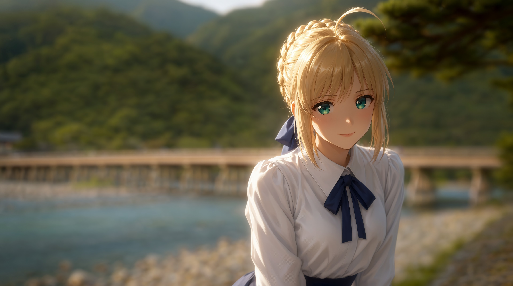
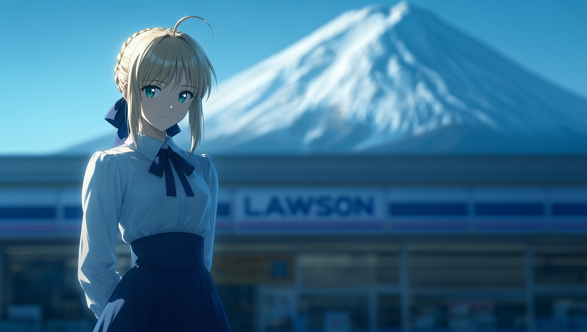

<p align="right">
  <b>English</b> | <a href="README.md">中文说明</a>
</p>

# comfy2antigravity

> **Universal Local ComfyUI Image Generation, High-Fidelity Editing & 4K Upscaling Skill for All AI Coding Agents**

[]()
[]()
[]()
[](https://github.com/Ekzykesax/comfy2antigravity)
[]()
[]()
[]()
[](LICENSE)

Encapsulates local ComfyUI image creation and manipulation into a **frictionless agentic experience**: **Zero node connections, zero manual tuning, universally compatible across all AI agents**. Neither users nor autonomous agents need to deal with complex graph noodles. Through natural language or lightweight standard-library Python CLIs, agents can perform health-checks, multi-modal slot mapping, sampling, 4K optical bokeh upscaling, and organized asset archiving.

Includes out-of-the-box pipelines for high-fidelity text-to-image, reference-guided generation, universal instruction-based image editing, and 2D anime + real photo blending (based on Qwen-Image 2.1 architecture), while also supporting custom ComfyUI API JSON workflows.

---

## Showcase

| Kyoto Arashiyama Togetsukyo Bridge (Blending / 4K/8K Upscale) | Kawaguchiko Lawson Mt. Fuji (Telephoto Depth / 4K Upscale) |
| :---: | :---: |
|  |  |
| Glowing rim lighting + sculpted chiaroscuro + optical creamy bokeh | Telephoto street compression + seamless anime integration |

<p align="center">
  
</p>

---

## Key Features

1. **Zero UI Interaction (No Noodles, No Manual Tuning)**:
   - Eliminates manual ComfyUI canvas operations; all complex wiring and parameter scheduling are handled automatically.
   - Automatically handles multi-modal tensor mappings (such as `images.image_1` / `images.image_2` slots), avoiding ambiguous boolean tensor runtime exceptions.
2. **Native Compatibility with All AI Coding Agents**:
   - **Claude Code**: Invoke cross-platform Python CLIs directly inside tool calls or project rules;
   - **Cursor / Windsurf**: Add to `.cursorrules` or `.windsurfrules` for automated discovery and execution;
   - **Roo Code / Cline**: Import into Custom Instructions to empower agents with autonomous image generation and editing;
   - **Google Antigravity**: Loaded natively via `SKILL.md` with in-chat image rendering and mobile Remote Studio lightbox support;
   - **DeepSeek Harness (`dsh`)**: One-click plugin installation via `package.json`;
   - **OpenAI Codex / Aider / OpenCode**: Pure Python 3 standard library scripts (zero external pip dependencies) outputting clean JSON to `stdout`.
3. **Multi-Modal Character & Style Consistency**: Supports single or dual reference image inputs. Separates character identity from text prompts, ensuring reliable visual consistency without contradictory hallucination.
4. **Dedicated Dual-Pipeline Sampling Strategy**:
   - **Text-to-Image / Reference Generation**: Employs Viggle Turbo 8-step sampling (`Euler / Simple`, CFG 1.0) with empty latent random noise diffusion, achieving complete denoising trajectory convergence;
   - **Universal High-Fidelity Editing**: Uses official native 25-step sampling with **strictly NO turbo LoRA**. Features `resolution = 0` to preserve the original aspect ratio and latent anchoring directly from source image latents, ensuring 1:1 pixel fidelity for untouched regions (backgrounds, lighting, facial geometry);
   - **2D Anime + Real Photo Blending**: Dual-reference routing (Character Ref + Real Scenery Ref) under native 25 steps, sculpted with painterly ambient occlusion and volumetric lighting, completely eliminating heavy black outlines and uncanny 3D plastic artifacts.
5. **4K Focus-Aware Bokeh-Preserving Upscale (Focus-Aware Bokeh)**:
   - Powered by **`4x_foolhardy_Remacri.pth`** with dual-stream gradient-feathered focus fusion;
   - Sharp in-focus subjects (facial details, eyes, hair strands, fabric textures) undergo neural 4K reconstruction;
   - Defocused backgrounds (distant scenery, creamy bokeh circles) are smoothly enlarged mathematically, preventing artificial over-sharpening and harsh noise artifacts in blurred regions.
6. **Auto Health Check & Silent Recovery**: Probes the ComfyUI API endpoint (`http://127.0.0.1:8188`) before task execution and silently starts the background service if offline.
7. **Proactive Preprocessing & Organized Archiving**:
   - Automatically downscales input reference images to within 768px on the long edge, preventing VRAM overflow and eliminating shared GPU memory paging penalties;
   - Organizes all outputs under `ComfyUI生图成果/` with strict segregation between `全年龄/` (General / All-Ages) and `NSFW/` directories.

---

## Universal Agent Integration Guide

Easily integrate this skill into any autonomous coding environment:

### 1. Claude Code (Anthropic)
Reference `AGENTS.md` in your project's `CLAUDE.md`:
```markdown
# Image Generation & Editing Tooling
Use the Python scripts under `scripts/` to generate, edit, or upscale images via local ComfyUI.
Refer to `AGENTS.md` for CLI argument specifications and structured JSON output.
```

### 2. Cursor / Windsurf
Add the following rule to `.cursorrules` or `.windsurfrules`:
```markdown
When the user requests to generate, edit, blend, or upscale images:
1. Call `python scripts/generate.py`, `python scripts/edit_image.py`, `python scripts/blend_anime_real.py`, or `python scripts/upscale_image.py`.
2. Parse the JSON output on stdout to locate the resulting file under `ComfyUI生图成果/`.
3. Check `AGENTS.md` for complete parameter references.
```

### 3. Roo Code / Cline (VS Code)
Include the instructions from `AGENTS.md` in your Custom Instructions or project prompts.

### 4. Google Antigravity
Clone directly into your workspace skills directory. Antigravity will discover it automatically via `SKILL.md`:
```bash
git clone https://github.com/Ekzykesax/comfy2antigravity.git .agents/skills/comfy2antigravity
```

### 5. DeepSeek Harness (`dsh`)
Install using the dsh plugin manager:
```bash
dsh plugin add https://github.com/Ekzykesax/comfy2antigravity.git
```

### 6. OpenAI Codex / Aider / OpenCode / Standalone Terminal
Clone the repository and run using standard Python 3 (no pip installation required):
```bash
git clone https://github.com/Ekzykesax/comfy2antigravity.git
```

---

## Model Preparation

Ensure local ComfyUI is listening at `http://127.0.0.1:8188`. Download and place the following models into their corresponding directories:

| Model Category | Recommended File | Target Directory | Hugging Face Source |
| :--- | :--- | :--- | :--- |
| **Diffusion Base Model** | `NoctQ_V4_int8_convrot.safetensors` | `ComfyUI/models/diffusion_models/` | [Noct-Q Qwen-Image 2.1](https://huggingface.co/Noctaluna/Noct-Q-Uncensored-Qwen-Image-2.1) |
| **Acceleration LoRA (Optional)** | `Qwen-Image-2.1-viggle-turbo-4step-lora-r64.safetensors` | `ComfyUI/models/loras/` | [Viggle Turbo](https://huggingface.co/Viggle/Qwen-Image-2.1-viggle-turbo) |
| **Multi-modal Encoder** | `qwen3vl_8b_nvfp4.safetensors` | `ComfyUI/models/clip/` | [Qwen3-VL](https://huggingface.co/Comfy-Org/Qwen3-VL) |
| **VAE Codec** | `qwen_image_2.1_vae_bf16.safetensors` | `ComfyUI/models/vae/` | [Qwen-Image-2.1 VAE](https://huggingface.co/Comfy-Org/Qwen-Image-2.1) |
| **4K Upscaler Model** | `4x_foolhardy_Remacri.pth` | `ComfyUI/models/upscale_models/` | [4x_foolhardy_Remacri](https://huggingface.co/FacehugmanIII/4x_foolhardy_Remacri) |

> Tip: Custom model file names can be specified via `--unet` or `--lora` CLI arguments.

---

## Usage Examples

### 1. Pure Text-to-Image
- **Natural Language**: *"Generate a cyberpunk rainy street at night, neon lights reflecting on puddles, cinematic volumetric lighting."*
- **Python CLI (Cross-Platform / Universal Agent)**:
  ```bash
  python scripts/generate.py --prompt "Cyberpunk rainy street at night, neon reflections on puddles, cinematic lighting" --width 1344 --height 768
  ```
- **PowerShell (Windows)**:
  ```powershell
  powershell -ExecutionPolicy Bypass -File "scripts/generate.ps1" -Prompt "Cyberpunk rainy street at night..." -Width 1344 -Height 768
  ```

### 2. Reference-Guided Generation (Character Consistency)
- **Natural Language**: *"Using input/sakiko_ref.png as character reference, generate an illustration of her playing a grand piano indoors with warm ambient lighting."*
- **Python CLI (Cross-Platform / Universal Agent)**:
  ```bash
  python scripts/generate.py --ref-image "input/sakiko_ref.png" --prompt "Character playing an elegant grand piano, warm indoor ambient lighting"
  ```
- **PowerShell (Windows)**:
  ```powershell
  powershell -ExecutionPolicy Bypass -File "scripts/generate.ps1" -RefImage "input/sakiko_ref.png" -Prompt "Character playing an elegant grand piano..."
  ```

### 3. Universal High-Fidelity Image Editing (Outfits / Poses / Lighting)
Editing does not use turbo LoRA. Native 25-step sampling with original image latent anchoring modifies strictly the targeted elements while preserving untouched areas 1:1.

- **Single-Image Instruction Edit**:
  ```bash
  python scripts/edit_image.py --image "photo.jpg" --prompt "Change the casual jacket to an elegant black evening dress, keep face and background strictly unchanged"
  ```
- **Cross-Image Outfit Transfer (Dual References)**:
  ```bash
  python scripts/edit_image.py --image "person.jpg" --second-image "dress.png" --prompt "Replace the outfit in image 1 with the dress design in image 2, preserve facial features and background"
  ```

### 4. 2D Anime + Real-Photo Blending
Seamlessly integrates 2D anime characters into real photographic backgrounds, producing rich painterly depth and optical bokeh while preventing 3D plastic textures and thick black lineart.

- **Natural Language**: *"Blend the character from saber_ref.png into tokyo_night.jpg naturally, preserving rich oil-painting lighting depth."*
- **Python CLI (Cross-Platform / Universal Agent)**:
  ```bash
  python scripts/blend_anime_real.py --char-ref "saber_ref.png" --bg-ref "tokyo_night.jpg" --resolution "3M"
  ```
- **PowerShell (Windows)**:
  ```powershell
  powershell -ExecutionPolicy Bypass -File "scripts/blend_anime_real.ps1" -CharRef "saber_ref.png" -BgRef "tokyo_night.jpg" -Resolution "3M"
  ```

### 5. 4K/8K Focus-Aware Optical Bokeh Upscaling
Solves the conventional upscaler flaw of over-sharpening camera bokeh. Sharp subjects are reconstructed at 4K/8K resolution while background optical blur remains creamy and natural.

- **Natural Language**: *"Upscale the generated artwork to 4K (or 8K), preserving natural optical background bokeh."*
- **Python CLI (Cross-Platform / Universal Agent)**:
  ```bash
  # 4K Upscale
  python scripts/upscale_image.py --image "output/portrait.png" --target_width 3840

  # 8K Extreme Upscale (33 Megapixels)
  python scripts/upscale_image.py --image "output/portrait.png" --target_width 7680
  ```
- **PowerShell (Windows)**:
  ```powershell
  powershell -ExecutionPolicy Bypass -File "scripts/upscale_image.ps1" -Image "output/portrait.png" -Width 3840
  ```

---

## Repository Structure

```text
comfy2antigravity/
├── README.md                # Chinese Documentation (with Multi-Agent Integration Guide)
├── README_EN.md             # English Documentation (Universal Multi-Agent Guide)
├── AGENTS.md                # Universal AI Coding Agent Guidelines & CLI Interface Specification
├── SKILL.md                 # Antigravity Agent Skill Configuration
├── package.json             # DeepSeek Harness (dsh) plugin manifest & tool definitions
├── plugin.json              # Antigravity plugin metadata manifest
├── LICENSE                  # Apache 2.0 Open Source License
├── workflows/
│   ├── 图像编辑_原生25步_NoctQ.json        # ComfyUI GUI Workflow (Native 25-step Pure Editing)
│   └── 二次元实景融合_原生25步_NoctQ.json  # ComfyUI GUI Workflow (Togetsukyo Dual-Ref Blend)
└── scripts/
    ├── generate.py          # Cross-platform Python T2I & Reference Gen (Universal Agent)
    ├── edit_image.py        # Cross-platform Python High-Fidelity Editing (Universal Agent)
    ├── blend_anime_real.py  # Cross-platform Python Anime + Real Blending (Universal Agent)
    ├── upscale_image.py     # Cross-platform Python 4K Focus-Aware Bokeh Upscaling
    ├── save_finished.py     # Cross-platform Python Masterpiece Archiving
    ├── generate.ps1         # Windows PowerShell T2I & Reference Gen
    ├── edit_image.ps1       # Windows PowerShell Image Editing
    ├── blend_anime_real.ps1 # Windows PowerShell Anime + Real Blending
    ├── upscale_image.ps1    # Windows PowerShell 4K Bokeh Upscaling
    ├── save_finished.ps1    # Windows PowerShell Masterpiece Archiving
    ├── generate_gguf.ps1    # Specialized GGUF text encoder runner
    ├── run_workflow.ps1     # Custom ComfyUI API JSON workflow executor
    └── start_comfyui.ps1    # Service health check & background auto-start
```

---

## License

This project is licensed under the [Apache License 2.0](LICENSE).
